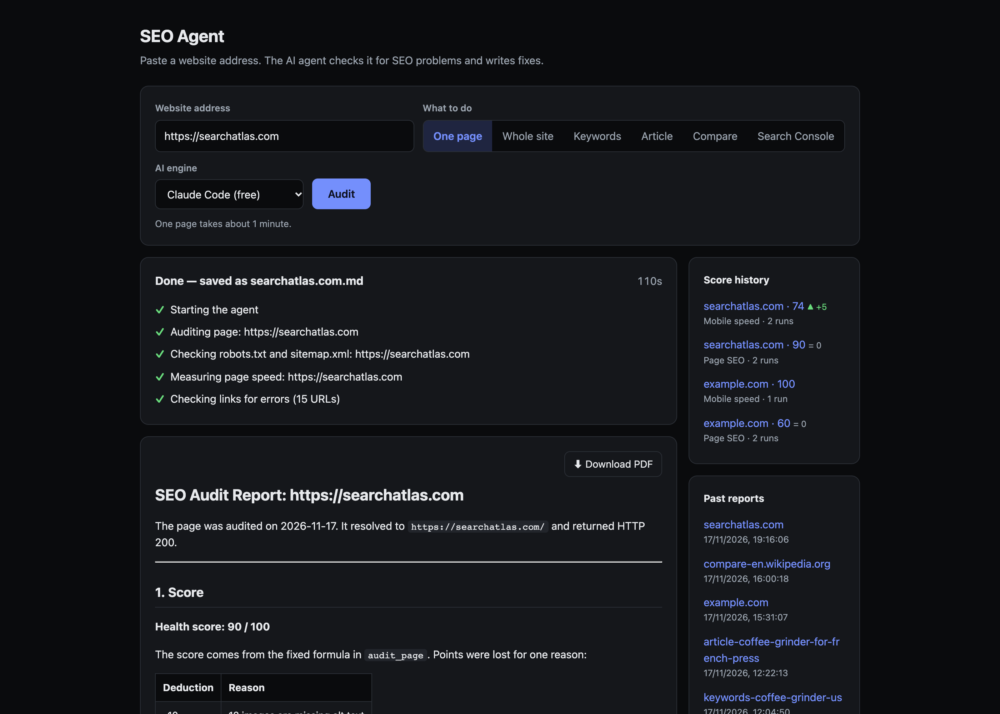
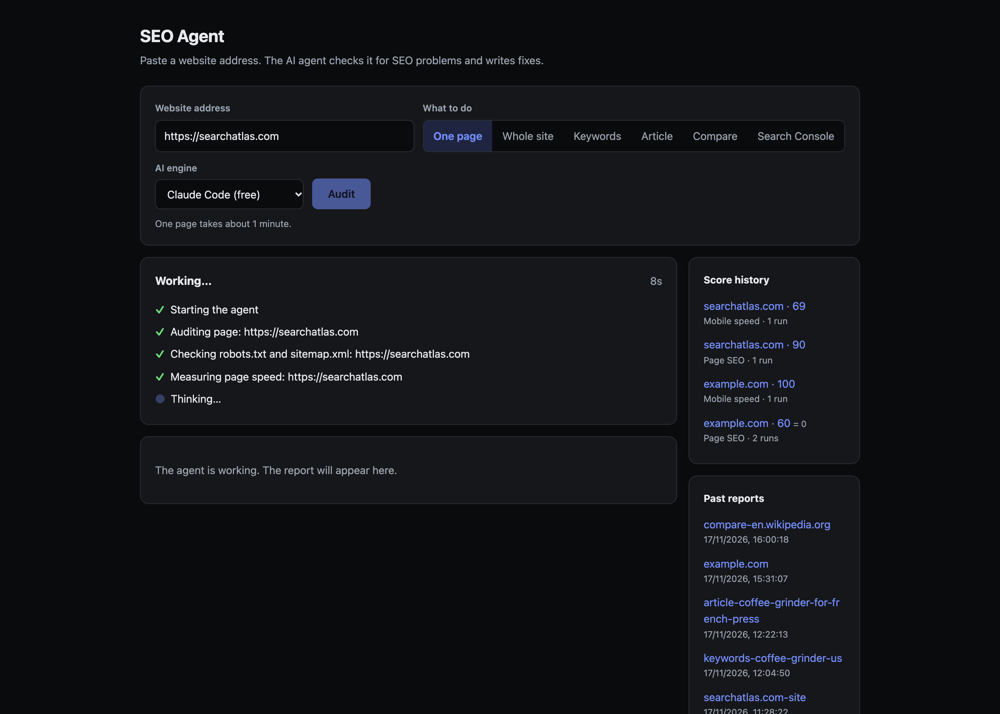
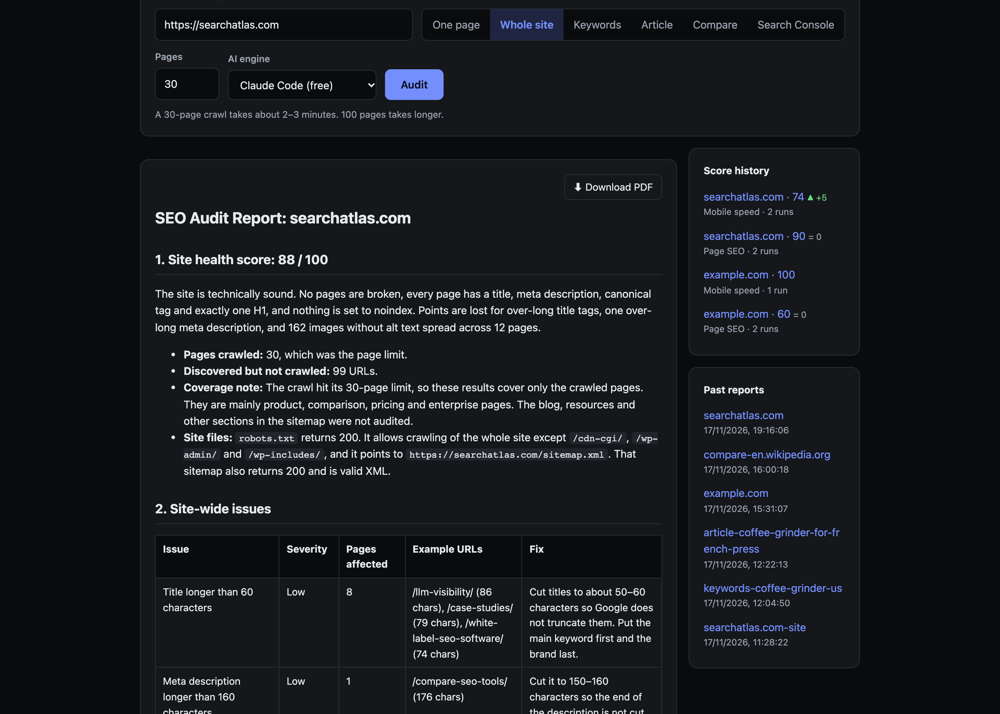
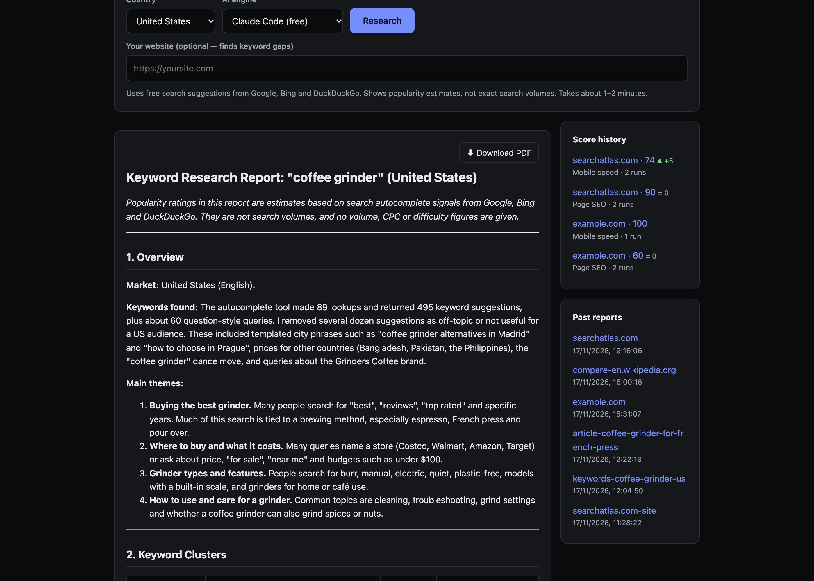
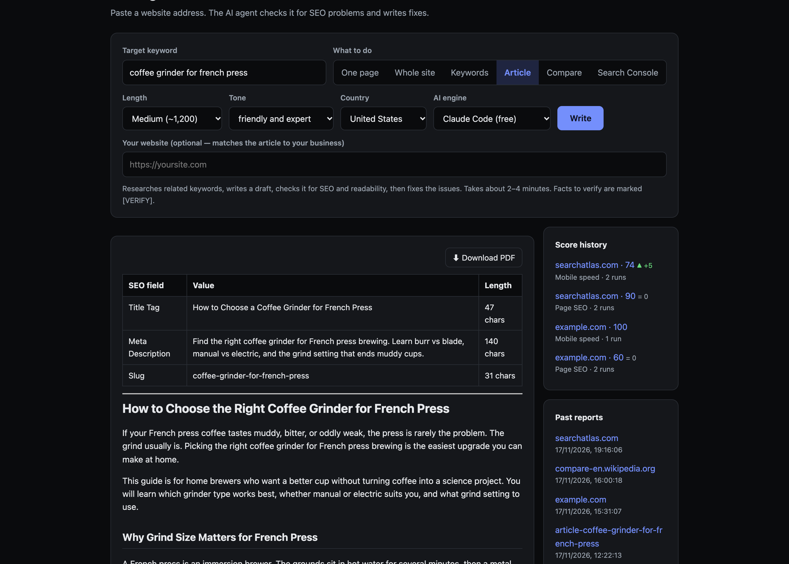
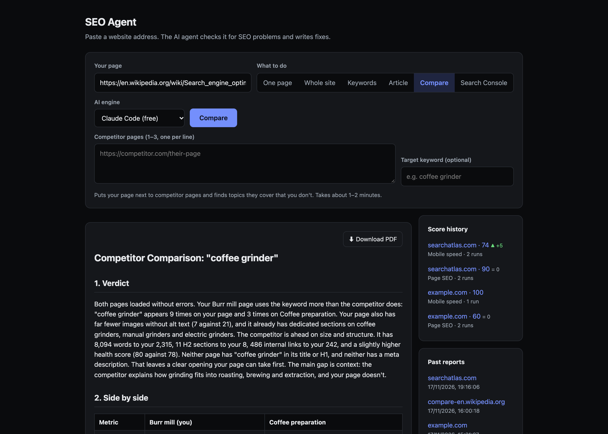
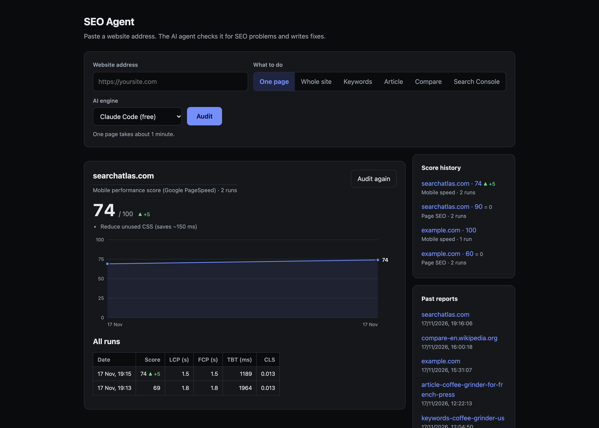

# SEO Agent

An AI SEO assistant in Python, inspired by platforms like Search Atlas. It audits pages and whole sites, researches keywords, writes SEO articles, compares you with competitors, reads your Google Search Console data, measures page speed, and re-checks your sites every week.

Claude (Anthropic) does the reasoning and writing. All **measurements and scores come from code**, never from the model, so results are repeatable and can be tracked over time.

```
                ┌──────────────┐
  CLI / Web UI ─►  agent loop  ├─► tools (Python) ─► the web, Google APIs
                │  (Claude)    │◄─ JSON results
                └──────┬───────┘
                       ▼
               Markdown report ─► reports/  ─► PDF
                                ─► score history (SQLite) ─► weekly re-audits
```



## Screenshots

| Agent working live | Whole-site crawl |
|---|---|
|  |  |
| **Keyword research** | **SEO article writer** |
|  |  |
| **Competitor comparison** | **Score history** |
|  |  |

## Features

| Feature | What it does | Docs |
|---|---|---|
| Page audit | Title, meta, headings, images, canonical, robots, links, 0–100 score, PageSpeed | [docs/page-audit.md](docs/page-audit.md) |
| Site crawl | Crawls up to 100 pages, finds broken pages, duplicates, thin pages, weak internal links | [docs/site-crawl.md](docs/site-crawl.md) |
| Keyword research | Free autocomplete from Google, Bing and DuckDuckGo, grouped by intent, 5 markets | [docs/keywords.md](docs/keywords.md) |
| Article writer | Writes an SEO article, checks it with 16 rules, fixes it until it passes | [docs/article-writer.md](docs/article-writer.md) |
| RAG (site knowledge) | Indexes your site; the agent searches it (hybrid vector + keyword) so brand facts come with sources | [docs/rag.md](docs/rag.md) |
| Competitor compare | Your page vs up to 3 competitors, side by side, plus content gaps | [docs/compare.md](docs/compare.md) |
| Search Console | Your real Google clicks, impressions and positions, with opportunities | [docs/search-console.md](docs/search-console.md) |
| Page speed | Core Web Vitals and Lighthouse score from Google PageSpeed Insights | [docs/page-speed.md](docs/page-speed.md) |
| Score history | Every score is saved so you can see trends | [docs/score-history.md](docs/score-history.md) |
| Weekly monitoring | Re-audits watched pages every Monday 9:00, alerts on a 5+ point drop | [docs/weekly-monitoring.md](docs/weekly-monitoring.md) |
| PDF export | Turns any report into a clean client-ready PDF | [docs/pdf-export.md](docs/pdf-export.md) |
| Web UI | Dark-theme web page for all of the above, with live progress | [docs/web-ui.md](docs/web-ui.md) |
| Two engines | Anthropic API (paid) or Claude Code on your subscription (free) | [docs/engines.md](docs/engines.md) |
| Tools reference | Every tool, its inputs and how to call it from the terminal | [docs/tools.md](docs/tools.md) |

## Requirements

- Python 3.11+
- macOS or Linux (weekly alerts and PDF export use macOS features; see the docs for each)
- One of:
  - an **Anthropic API key** with credit (`--engine api`), or
  - **Claude Code** installed and logged in (`--engine free`, uses your Claude subscription)
- Optional: Google Chrome (PDF export), a Google API key (page speed), a Google Cloud OAuth client (Search Console)

## Setup

```bash
git clone <your-repo-url> seo-agent
cd seo-agent
python3 -m venv .venv
.venv/bin/pip install -r requirements.txt
cp .env.example .env
```

Then open `.env` and fill in your keys (see below).

## Environment variables

Put these in `.env` in the project root. `.env` is git-ignored, so never commit it.

| Variable | Required? | Used for | Where to get it |
|---|---|---|---|
| `ANTHROPIC_API_KEY` | Only for `--engine api` | Calls Claude through the Anthropic API | [console.anthropic.com](https://console.anthropic.com) → API Keys |
| `PAGESPEED_API_KEY` | For page speed | Google PageSpeed Insights (Core Web Vitals). Without it, speed checks are skipped or fail with a quota error | Google Cloud console → enable **PageSpeed Insights API** → Credentials → API key |
| `SEO_AGENT_DB` | No | Path of the SQLite history database. Default: `data/history.db` (handy for tests) | — |
| `SEO_AGENT_RAG_DB` | No | Path of the RAG index database. Default: `data/rag.db` | — |

Example `.env`:

```dotenv
ANTHROPIC_API_KEY=sk-ant-...
PAGESPEED_API_KEY=AIza...
# SEO_AGENT_DB=/tmp/test-history.db
```

The free engine deliberately **removes** `ANTHROPIC_API_KEY` from its environment so Claude Code uses your subscription login instead of API credit.

### Files that act like secrets (also git-ignored)

| File | What it is |
|---|---|
| `data/gsc_client_secret.json` | Google OAuth "Desktop app" client, downloaded from Google Cloud (Search Console only) |
| `data/gsc_token.json` | Your Search Console sign-in token, created by `gsc.py login` |

See [docs/search-console.md](docs/search-console.md) for the full Google setup.

## Run it

### Web UI

```bash
./run_web.sh
```

Open http://localhost:8000. Pick a mode, enter a URL or keyword, and watch the agent work. Stop it with Ctrl+C. The weekly scheduler runs inside this server.

### Terminal

Use `--engine free` (or the `./audit_free.sh` shortcut) for the Claude Code engine, or `--engine api` for the Anthropic API.

```bash
# Audit one page
./audit_free.sh https://example.com

# Crawl and audit a whole site (up to 30 pages, max 100)
./audit_free.sh https://example.com --site --pages 30

# Keyword research (markets: us, gb, in, ca, au)
./audit_free.sh "coffee grinder" --keywords --country us
./audit_free.sh "coffee grinder" --keywords --mysite https://mysite.com   # with keyword gaps

# Write an SEO article
./audit_free.sh "coffee grinder for french press" --article --length 1200 --tone "friendly and expert"

# Compare your page with up to 3 competitors
./audit_free.sh https://mysite.com/page --compare https://rival1.com/page https://rival2.com/page --keyword "coffee grinder"

# Google Search Console report
./audit_free.sh https://mysite.com --gsc

# Same jobs on the paid API engine
.venv/bin/python main.py https://example.com --engine api
```

Every report is saved to `reports/<name>.md`; articles also leave a draft in `drafts/`.

### Other commands

```bash
# Weekly monitoring
.venv/bin/python monitor.py add https://mysite.com
.venv/bin/python monitor.py add https://mysite.com --site --pages 30
.venv/bin/python monitor.py list
.venv/bin/python monitor.py run --all
.venv/bin/python monitor.py remove 3

# Score history
.venv/bin/python history.py

# RAG index over a site's own content
.venv/bin/python rag.py index https://mysite.com --pages 30
.venv/bin/python rag.py search mysite.com "what plans are offered"
.venv/bin/python rag_eval.py

# PDF export
.venv/bin/python export_pdf.py reports/example.com.md

# Search Console sign-in
.venv/bin/python gsc.py login
.venv/bin/python gsc.py sites
.venv/bin/python gsc.py status

# Run one tool directly and print its JSON
.venv/bin/python tools_cli.py audit_page https://example.com
```

### All `main.py` options

| Option | Default | Meaning |
|---|---|---|
| `target` | — | URL to audit, or a keyword with `--keywords` / `--article` |
| `--site` | off | Crawl and audit the whole site |
| `--pages N` | 30 | Max pages to crawl (1–100) |
| `--keywords` | off | Keyword research for a seed keyword |
| `--article` | off | Write an SEO article for a keyword |
| `--length N` | 1200 | Article length in words |
| `--tone TEXT` | `friendly and expert` | Article tone of voice |
| `--country` | `us` | Keyword market: `us`, `gb`, `in`, `ca`, `au` |
| `--mysite URL` | — | Your website (keyword gaps, or brand context for articles) |
| `--compare URL…` | — | Compare the target with 1–3 competitor URLs |
| `--keyword TEXT` | — | Target keyword for `--compare` |
| `--gsc` | off | Report from your Google Search Console data |
| `--engine` | `api` | `api` (Anthropic API) or `free` (Claude Code) |

## Project structure

```
seo-agent/
├── main.py            CLI entry point, report naming, run_job()
├── agent.py           Prompts for each mode + the Anthropic API agent loop
├── free_engine.py     Same jobs through headless Claude Code (free engine)
├── tools.py           All tools + the scoring formulas
├── tools_cli.py       Runs one tool from the shell (used by the free engine)
├── gsc.py             Google Search Console sign-in and analysis
├── rag.py             RAG: chunk, embed, store, hybrid search (search_knowledge tool)
├── rag_eval.py        Retrieval eval: recall@5 and MRR for keyword / vector / hybrid
├── history.py         SQLite score history
├── monitor.py         Weekly re-audits + alerts
├── export_pdf.py      Markdown report -> PDF via headless Chrome
├── app.py             FastAPI web server + JSON API
├── web/index.html     The web UI (single page, dark theme)
├── run_web.sh         Starts the web server
├── audit_free.sh      Shortcut: main.py with --engine free
├── requirements.txt
├── .env.example
├── docs/              One page per feature
├── reports/           Saved reports (git-ignored)
├── drafts/            Article drafts (git-ignored)
└── data/              History DB, RAG index, embedding model, Google OAuth files (git-ignored)
```

## Design choices

- **Agent = model + tools + loop.** Claude decides which tools to call; Python does the fetching and measuring.
- **Scores come from code** (`tools.score_page`, `crawl_site`). The prompt tells the model to use the tool's `health_score` exactly, so trends are comparable week to week.
- **No invented numbers.** Autocomplete gives a popularity signal, not search volume. The article writer may state a brand fact only if RAG retrieved it from the site, with the source URL; anything else becomes `[VERIFY: …]`.
- **Read-only and polite.** The agent only sends GET requests, respects `robots.txt`, and Search Console access uses the read-only scope.
- **Safe by default.** The web server binds to `127.0.0.1`, crawled HTML is never rendered as HTML in the UI, and the free engine may only run `tools_cli.py` and edit files inside `drafts/`.

## Known limits

- Keyword research has no search-volume numbers (free autocomplete only).
- Page speed needs `PAGESPEED_API_KEY`.
- Weekly alerts use macOS notifications; PDF export expects Google Chrome at the default macOS path.
- The paid API engine and live Search Console data have not been tested end to end yet.
