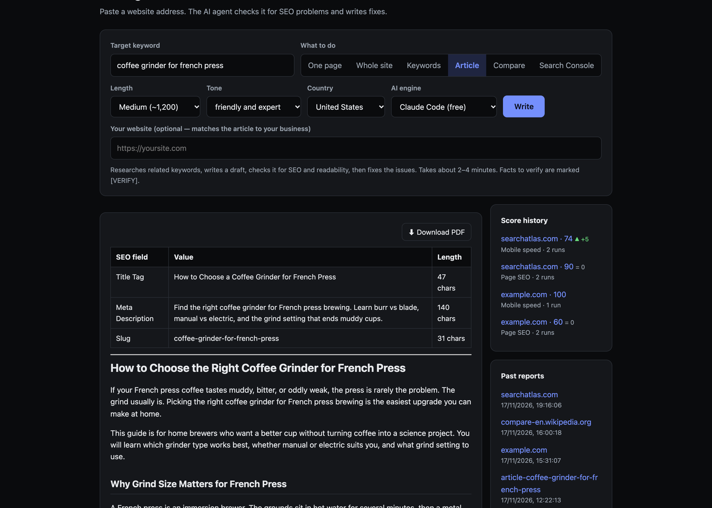

# SEO article writer

Writes a complete, publish-ready article for a target keyword, then checks it against 16 SEO and readability rules and fixes it until it passes. This is a **write → check → fix** loop.



## Run it

```bash
./audit_free.sh "coffee grinder for french press" --article
./audit_free.sh "coffee grinder for french press" --article --length 1500 --tone "casual" --country gb
./audit_free.sh "coffee grinder" --article --mysite https://mysite.com   # fits the article to your brand
```

Web UI: mode **Article**, with Length, Tone, Country and "Your website" fields.

Output:
- `reports/article-<slug>.md`: the final article plus SEO notes (the front matter is shown as a table)
- `drafts/<slug>.md`: the working draft

## Steps the agent follows

1. **Research**: `keyword_suggestions` gives 5–8 supporting keywords and 4–6 real questions.
2. **Brand facts** (optional, with `--mysite`): 3–5 focused `search_knowledge` calls ([RAG](rag.md)) over your site. Only facts found in those passages may be used, and their URLs are listed under *Sources used*.
3. **Write** the draft with front matter (`title_tag`, `meta_description`, `slug`), one H1, 4–8 H2 sections, an FAQ and a conclusion.
4. **Check** it with `check_draft`.
5. **Fix** everything in `issues_to_fix` and check again, at most 3 rounds.

## The 16 checks (`tools.check_draft`)

The checks are deterministic, run in code with no AI:

- Front matter present (`title_tag`, `meta_description`, `slug`)
- `title_tag` 30–60 characters and contains the keyword
- `meta_description` 120–160 characters and contains the keyword
- Slug short, lowercase and hyphenated
- Exactly one H1, which contains the keyword
- Keyword in the first 100 words
- At least 4 H2 sections, with the keyword (or most of its words) in at least one
- FAQ section present
- Keyword density 0.5–2.5%
- Flesch reading ease 50+
- Average sentence under 22 words
- No paragraph over 120 words

It returns `passed`, `issues_to_fix`, a `score` such as `16/16`, and measurements (word count, density, Flesch and more).

## No invented facts

The writer must never invent statistics, prices, studies or quotes. Where a fact would help, it writes `[VERIFY: what to check]`, and the SEO notes list every placeholder for you to check before publishing.

## Safety

On the free engine, Claude Code may edit files **only inside `drafts/`**, and `check_draft` only reads `drafts/*.md`.
