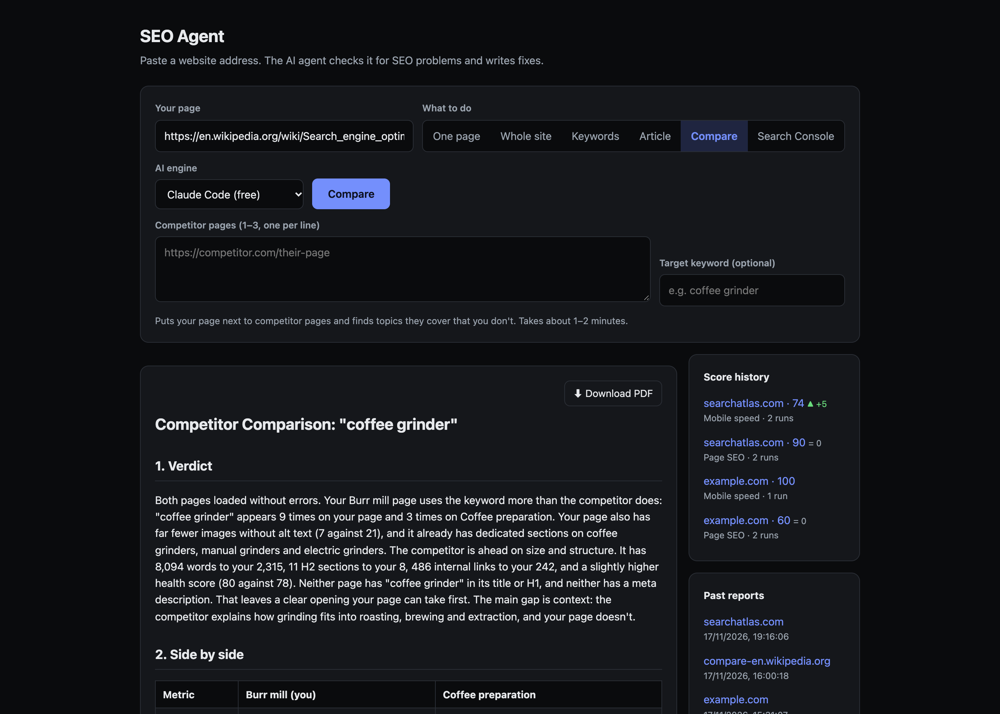

# Competitor comparison

Puts your page next to up to 3 competitor pages: SEO numbers side by side, plus the **content gap**, meaning topics the competitors cover that your page never mentions.



## Run it

```bash
./audit_free.sh https://mysite.com/grinders \
  --compare https://rival1.com/grinders https://rival2.com/best-grinders \
  --keyword "coffee grinder"
```

Web UI: mode **Compare**, with up to 3 competitor URLs and a keyword.

Report: `reports/compare-<host>.md`.

## How it works (`tools.compare_pages`)

For each page it runs `audit_page` and `page_topics` (full text), then computes:

- Health score, title and its length, word count, H2 count
- Whether the keyword is in the title and H1, and how often it's mentioned
- Images missing alt text and internal links
- **Content gap**: phrases and section topics that appear on competitor pages but not on yours, using the full page text rather than a sample

If a page fails to load, it's listed under errors and the comparison continues with the rest.

## Report sections

1. **Verdict**: where you're ahead and where you're behind
2. **Side by side**: one column per page, yours first
3. **Content gap**: missing topics grouped into 3–6 themes, each with a section to add
4. **What competitors do better**, with the matching fix
5. **Action plan**: 5 prioritised steps

The tool can't see rankings, traffic or backlinks, so the report never claims anything about them.
