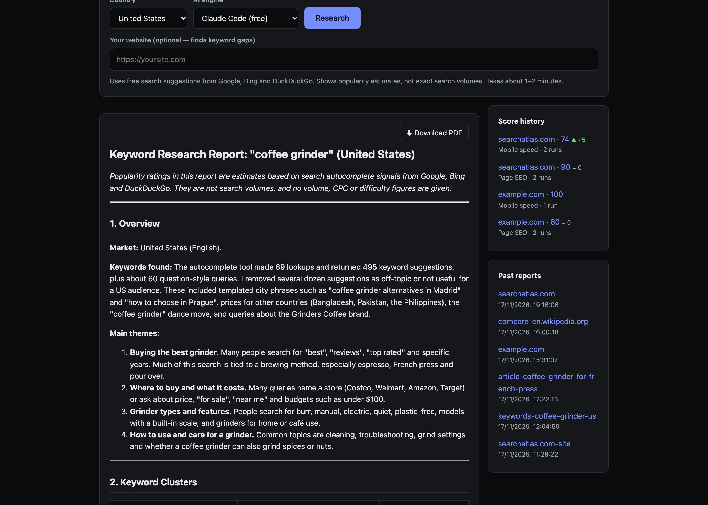

# Keyword research

Expands a seed keyword into real search phrases, groups them into topic clusters by search intent, and turns them into a content plan. It's free: it uses public search autocomplete, not a paid keyword database.



## Run it

```bash
./audit_free.sh "coffee grinder" --keywords
./audit_free.sh "coffee grinder" --keywords --country gb
./audit_free.sh "coffee grinder" --keywords --mysite https://mysite.com   # adds keyword gaps
```

Web UI: mode **Keywords**, with Country and optional "Your website" fields.

Report: `reports/keywords-<seed>-<country>.md`.

## Markets

| Code | Market |
|---|---|
| `us` | United States, English (default) |
| `gb` | United Kingdom |
| `in` | India |
| `ca` | Canada |
| `au` | Australia |

## How it works (`tools.keyword_suggestions`)

1. Asks the autocomplete endpoints for:
   - the seed (**Google, Bing and DuckDuckGo**);
   - the seed plus each letter a–z (Google);
   - question words and modifiers such as "how", "what", "best" and "free" (all three).
2. Runs about 90 lookups in parallel (6 threads), which takes about 15 seconds.
3. Drops off-topic suggestions: a suggestion must contain every word of the seed.
4. Scores each keyword with a **popularity signal**:
   - `hits`: how many lookups returned it
   - `best_rank`: its best position in any suggestion list (1 = top)
   - `sources`: which engines suggested it

**There are no search volumes.** Autocomplete shows what people type, not how often. The report says so under its title and rates popularity High / Medium / Low from the signal only. It never invents volumes, CPC or difficulty.

With `--mysite`, `page_topics` reads your page to find which clusters you already cover.

## Report sections

1. **Overview**: market, keyword count and main themes
2. **Keyword clusters**: Cluster | Intent | Top keywords | Popularity | Content to create
3. **Top 15 keywords to target**, favouring long-tail phrases
4. **Questions people ask**, useful for FAQs
5. **Content plan**: 5 articles with titles, keywords and H2 outlines
6. **Keyword gaps** (only with `--mysite`)
