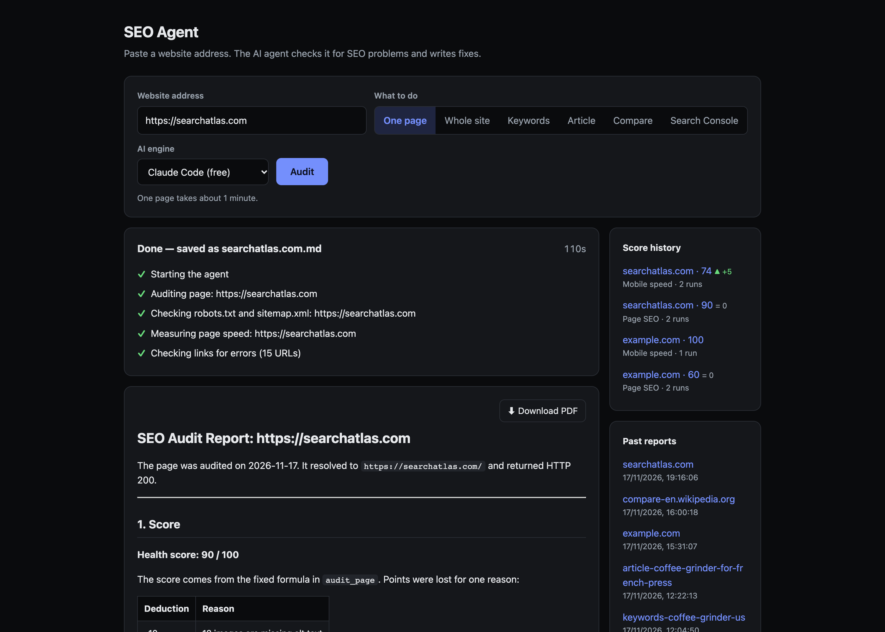

# Page audit

Audits a single URL for on-page SEO and writes a report with a 0–100 health score, an issues table, ready-to-paste fixes, a mobile speed section and the top 3 priorities.



## Run it

```bash
./audit_free.sh https://example.com                  # free engine
.venv/bin/python main.py https://example.com --engine api
```

Web UI: mode **One page**.

Report: `reports/<host>.md` (for example `reports/example.com.md`).

## What the agent does

1. `audit_page`: fetches the page once and extracts the title, meta description, headings, images, links, canonical, robots meta, viewport, `lang` and a text sample.
2. `check_site_files`: checks that `robots.txt` and `sitemap.xml` exist.
3. `check_links`: checks the HTTP status of up to 20 internal links.
4. `page_speed`: mobile Core Web Vitals (see [page-speed.md](page-speed.md)). If it fails, the report says so in one line and moves on.
5. Claude writes the report from the tool data only.

## Score formula (`tools.score_page`)

Each page starts at 100. Points are deducted in code, so the same page always gets the same score.

| Problem | Points |
|---|---|
| Page set to `noindex` | −20 |
| Missing `<title>` | −15 |
| Title outside 30–60 characters | −5 |
| Missing meta description | −10 |
| Meta description outside 70–160 characters | −3 |
| No H1 | −10 |
| More than one H1 | −5 |
| Thin content (under 300 words) | −10 |
| Images missing alt text | −1 each, max −10 |
| Missing canonical | −5 |
| No viewport meta (mobile) | −10 |
| No `lang` attribute | −3 |

The report lists every deduction so the reader can see where points were lost. The model must copy the score exactly and never invent its own.

## Report sections

1. **Score**, with its deductions
2. **Issues**: Issue | Severity | Evidence | Fix
3. **Ready-to-paste fixes**: a new `<title>`, meta description and H1 based on the page's real content
4. **Speed (mobile)**
5. **Top 3 priorities**

Every run is saved to the [score history](score-history.md).
