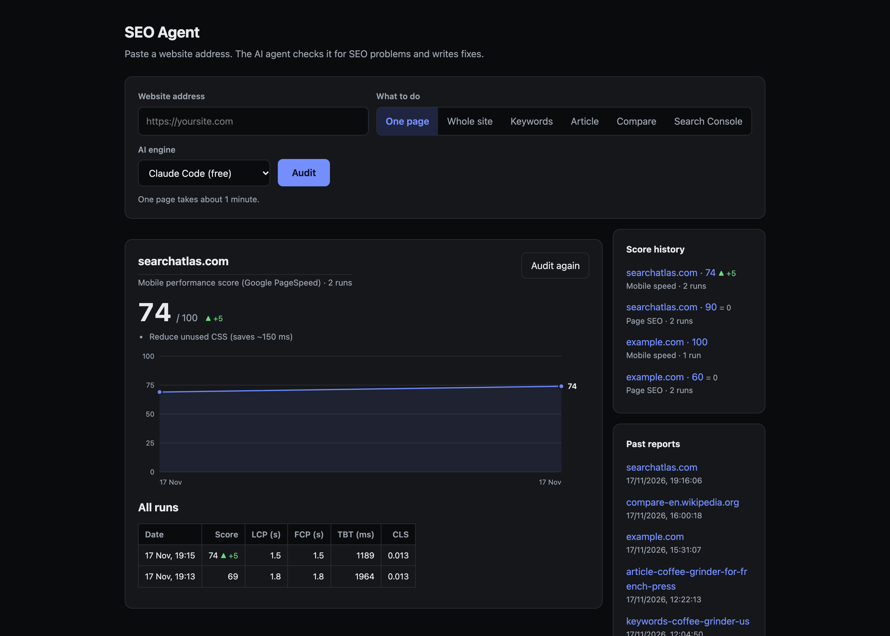

# Page speed (Core Web Vitals)

Measures page speed with Google's free **PageSpeed Insights API** (Lighthouse plus real-user Chrome data). It runs automatically as part of every [page audit](page-audit.md) and every weekly page check.



## Setup

Set `PAGESPEED_API_KEY` in `.env`:

1. Open [Google Cloud console](https://console.cloud.google.com) → APIs & Services → Library.
2. Enable **PageSpeed Insights API**.
3. Credentials → Create credentials → **API key**. Restricting it to the PageSpeed Insights API is recommended.
4. Add it to `.env`:

   ```dotenv
   PAGESPEED_API_KEY=AIza...
   ```

Without a key, Google's shared quota is almost always used up (HTTP 429), so the tool fails with a clear message instead.

## Run it on its own

```bash
.venv/bin/python tools_cli.py page_speed https://example.com mobile
.venv/bin/python tools_cli.py page_speed https://example.com desktop
```

## What it returns (`tools.page_speed`)

- **Performance score** (0–100)
- **Lab metrics**: LCP (main content shown), CLS (layout jumping), TBT (page frozen), FCP, Speed Index
- **Real-user Core Web Vitals** when Google has enough Chrome data: LCP, INP (response to clicks), CLS, each rated FAST / AVERAGE / SLOW, plus an overall rating
- **Top opportunities**: up to 8 speed fixes that each save at least 100 ms, biggest first

Each result is saved to the [score history](score-history.md) under mode `speed`.
