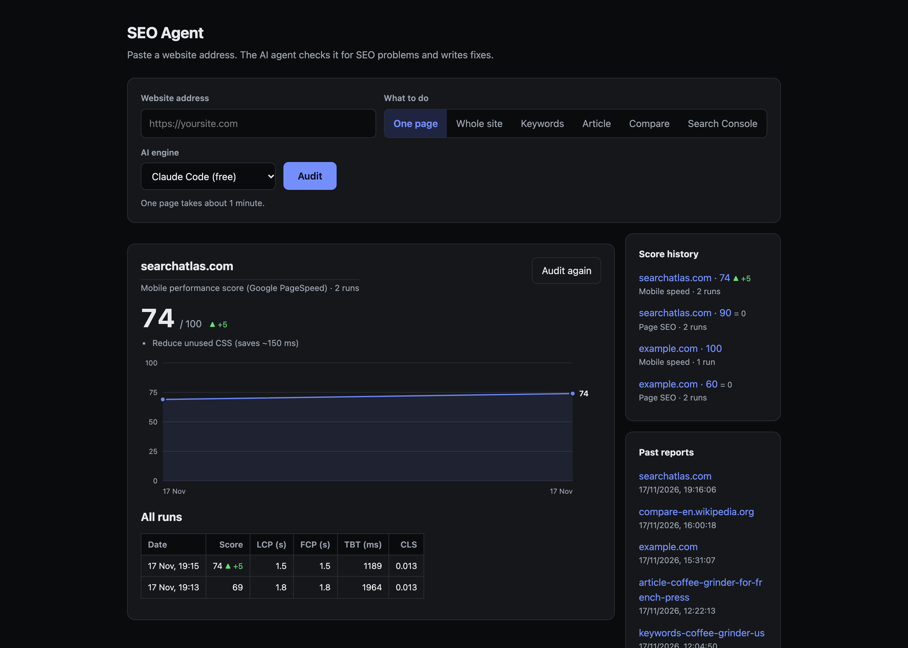

# Score history

Every score is saved so you can see whether a page or site is getting better or worse.



## How it works (`history.py`)

- SQLite database at `data/history.db`. Set `SEO_AGENT_DB` to use a different file, which is handy for tests.
- Saving happens **inside the tools** (`tools.run_tool` → `history.record_tool_result`), so it works the same on both engines, from the CLI, the web UI and the weekly monitor.

| Tool | Saved as mode | Score |
|---|---|---|
| `audit_page` | `page` | page health score |
| `crawl_site` | `site` | site health score |
| `page_speed` | `speed` | performance score |

Each row stores the time, mode, target, score and key metrics as JSON.

Because scores come from fixed formulas in code (see [page-audit.md](page-audit.md) and [site-crawl.md](site-crawl.md)), runs on different days are directly comparable.

## See it

Terminal:

```bash
.venv/bin/python history.py
```

Web UI: the **Score history** panel lists every tracked page and site. Click one to see:

- a line chart of the score over time (hover for the exact value and date)
- a table of every run with its key metrics
- a **Watch weekly** toggle (see [weekly-monitoring.md](weekly-monitoring.md))

## API

```
GET /api/history                                 # all tracked targets + latest score
GET /api/history/runs?mode=page&target=<target>  # every run for one target
```
