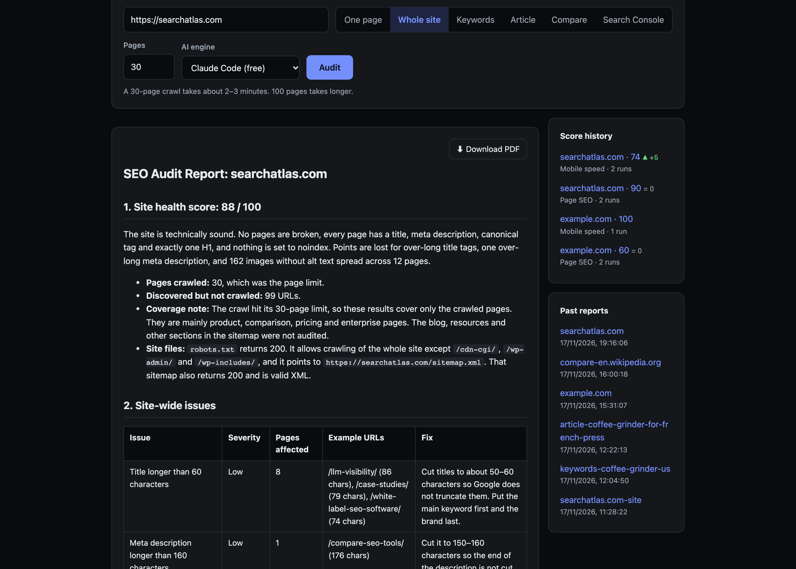

# Site crawl

Crawls a whole website (same domain only) and audits every page it reaches, then reports site-wide problems with one site health score.



## Run it

```bash
./audit_free.sh https://example.com --site --pages 30
.venv/bin/python main.py https://example.com --site --pages 50 --engine api
```

Web UI: mode **Whole site**, with a "Pages" field.

Report: `reports/<host>-site.md`.

`--pages` sets the maximum number of pages (1–100, default 30).

## How the crawler works (`tools.crawl_site`)

- Breadth-first from the start URL and follows internal links only.
- **Respects `robots.txt`**: it is fetched with `requests` and parsed, and blocked URLs are skipped and listed. If `robots.txt` can't be fetched (for example a firewall 403), the crawl still goes ahead.
- **Normalises URLs** (trailing slash, fragments) so one page is never counted twice.
- Read-only: only `GET` requests, a fixed timeout and a capped page count.

## What it finds

- Broken pages (4xx/5xx)
- Duplicate titles and duplicate meta descriptions
- Missing titles, meta descriptions and H1s, plus overly long tags
- Thin content (under 300 words)
- Missing canonical tags, `noindex` pages, images missing alt text
- URLs blocked by `robots.txt`
- Weakly linked pages (only one internal link points to them)

## Site score

```
site health = average page score (see page-audit.md)
              − 5 per broken page            (max −20)
              − 2 per duplicate-title group  (max −10)
              − 2 per duplicate-meta group   (max −10)
```

## Report sections

1. **Site health score**: average page score, site-wide deductions, pages crawled vs discovered
2. **Site-wide issues**: Issue | Severity | Pages affected | Example URLs | Fix
3. **Worst pages**: the 5 pages with the most problems
4. **Ready-to-paste fixes**: unique titles and meta descriptions for up to 3 pages
5. **Top 3 priorities**

Each crawl is saved to the [score history](score-history.md) under mode `site`.
