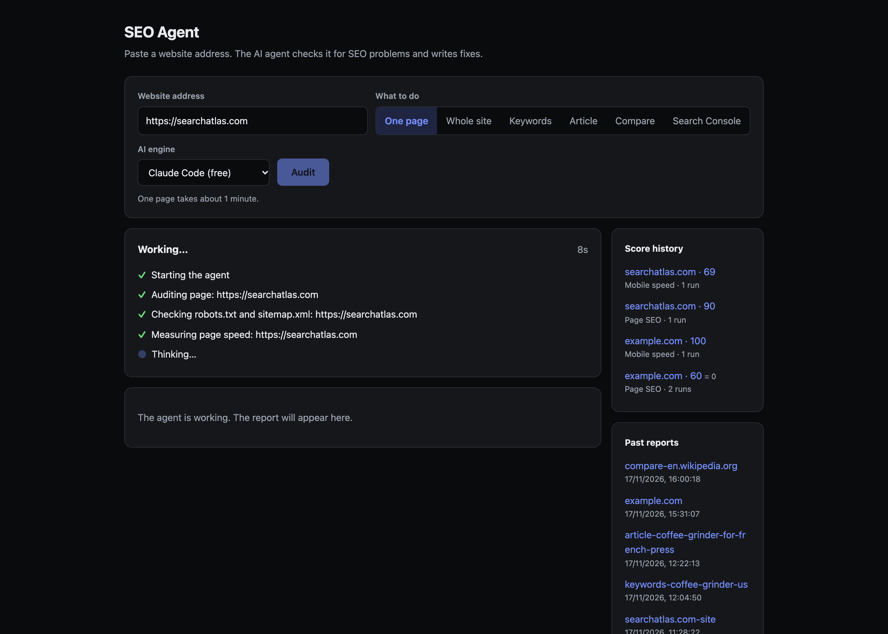

# Web UI

A single-page dark-theme web app for every feature, built with FastAPI and plain HTML/JS. No build step.



## Run it

```bash
./run_web.sh
```

Open http://localhost:8000 and stop it with Ctrl+C.

The server binds to `127.0.0.1` only, so it isn't reachable from other machines. It also runs the [weekly scheduler](weekly-monitoring.md).

## What's on the page

- **Mode picker**: One page, Whole site, Keywords, Article, Compare, Search Console. The form shows only the fields that mode needs (max pages, country, your website, length, tone, competitors, keyword).
- **Engine picker**: Free (Claude Code) or API.
- **Live progress**: each tool call appears as a step ("Auditing the page", "Checking speed", "Writing the draft", and so on) while the job runs.
- **Report view**: rendered Markdown, with **Download PDF**.
- **Score history**: chart and runs table for every tracked page and site, plus the **Watch weekly** toggle.
- **Past reports**: every report saved in `reports/`.
- **Search Console hint**: tells you what setup is missing and re-checks when you come back to the tab.

## How it works

- `POST /api/audit` starts the job in a **background thread** and returns a job id straight away.
- The page **polls** `GET /api/jobs/{id}` every 2 seconds for new steps and the final report.
- Reports are rendered with `markdown-it-py` with **HTML disabled**, because crawled content is untrusted.
- Report names are validated, so `/api/reports/{name}` can't be used to read files outside `reports/`.

## API reference

| Method | Path | Purpose |
|---|---|---|
| GET | `/` | The web page |
| POST | `/api/audit` | Start a job (body below) |
| GET | `/api/jobs/{id}` | Job status, steps and report |
| GET | `/api/reports` | List saved reports |
| GET | `/api/reports/{name}` | One report (Markdown + HTML) |
| GET | `/api/reports/{name}/pdf` | Report as PDF |
| GET | `/api/history` | Tracked targets and latest scores |
| GET | `/api/history/runs?mode=&target=` | All runs for one target |
| GET | `/api/gsc/status` | Search Console setup state |
| GET / POST / DELETE | `/api/watches[/{id}]` | Weekly watches |

`POST /api/audit` body:

```json
{
  "target": "https://example.com",
  "mode": "page | site | keywords | article | compare | gsc",
  "engine": "free | api",
  "max_pages": 30,
  "country": "us",
  "site": "https://mysite.com",
  "length": 1200,
  "tone": "friendly and expert",
  "competitors": ["https://rival.com/page"],
  "keyword": "coffee grinder"
}
```

Only `target` and `mode` are required. `competitors` takes at most 3 URLs.

## macOS note

If you start the server from a sandboxed tool and it can't read `~/Desktop`, that's macOS privacy protection (TCC). Run `./run_web.sh` from your own terminal instead.
